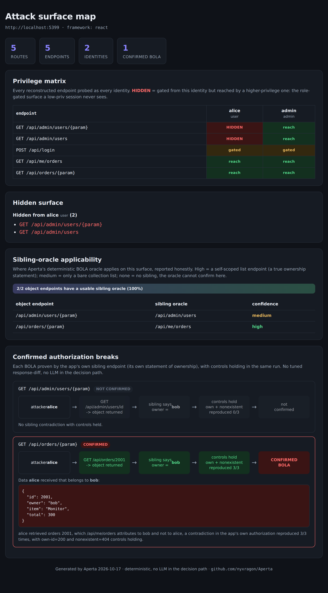
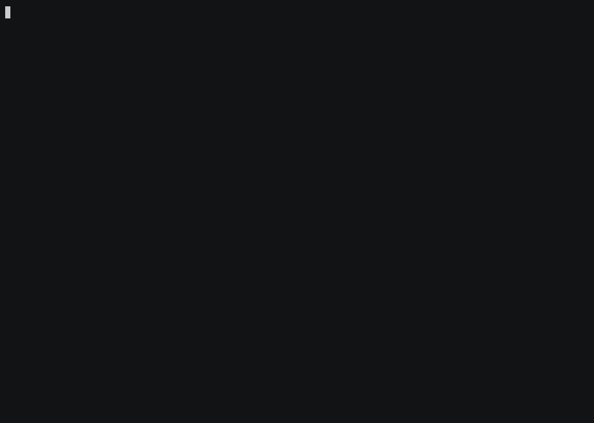

<div align="center">

# 🔓 Aperta

**Prove broken access control (BOLA/IDOR), deterministically, using the app's own behaviour as the oracle.**

[](https://github.com/nyxragon/Aperta/actions/workflows/ci.yml)
&nbsp;[](LICENSE)
&nbsp;
&nbsp;

[Demo](#demo) &nbsp;·&nbsp; [How it works](#how-the-proof-works) &nbsp;·&nbsp; [Install](#install) &nbsp;·&nbsp; [Usage](#use) &nbsp;·&nbsp; [Agents](#drive-it-from-an-agent)

</div>

A single-page app ships its entire API to the browser, hidden admin routes and all. Aperta rebuilds
that surface from the **stripped JavaScript bundle**, isolates the privileged part a low-privilege
session is never shown, and then does the one thing a proxy-replay plugin cannot: it makes the app
**prove its own broken access control**. When the app's own `/api/me/orders` says an object belongs
to the victim but still hands that object to the attacker, the app has contradicted itself, and that
contradiction *is* the finding.

No tuned response-diff, no LLM guess, the same verdict on every run, reproduced three times with
controls. The ids come from the victim's own list, so it confirms **BOLA / IDOR** on real UUIDs,
slugs, and GraphQL node ids, not just guessable integers, and the proof reads only request/response
behaviour, so it works on frameworks it has never seen. Autorize-style tools test the endpoints you
*clicked* and confirm with a fuzzy diff; Aperta tests the surface you never reached and proves
ownership from the app's own answers.

And it is **built for the agent era**: an AI hacking agent harvests the JavaScript and proposes what
to test, Aperta's deterministic oracle decides. Ships as a CLI, an MCP server, and a Claude Code
skill. (*Aperta* is Latin for "laid open".)

---

## Why

The surface where authorization bugs live is the one a low-privilege user never sees, and the usual
confirmation is a guess. Aperta closes both gaps where today's tools leave them open:

- **Proxy/traffic tools** (Autorize, Burp) only test endpoints you actually clicked, and confirm with response-similarity/length heuristics.
- **JS miners / crawlers** grab strings but can't rebuild routes assembled from minified variables.
- **LLM scanners** reason about ownership probabilistically, so the same run can disagree with itself.

## What it is: one path

Aperta runs a single path, and every command exists to serve it:

```
1. MAP     rebuild the app's full endpoint + route map from its JavaScript       (reconstruct)
2. DIFF    subtract what your low-priv login can reach  ->  the hidden,           (diff)
           role-gated surface where the access-control bugs live
3. PROVE   confirm a real cross-user access break on it, deterministically,       (prove)
           using the app's own behaviour as the oracle
```

`aperta report` runs all three and produces one self-contained HTML page. Every other command is a
helper for one of these three steps.

## How the proof works

`GET /api/orders/{id}` with no owner check is a broken-access-control bug (BOLA/IDOR). Aperta
confirms it not with a hand-tuned response-diff or an AI guess, but with a **contradiction inside the
app itself**: the app's own `GET /api/me/orders` is its statement of who owns what. When an attacker
pulls an object that endpoint attributes to another user, with own-id and nonexistent-id controls
holding and the result reproduced three times, the break is self-evident. The app is its own oracle.

The victim's real object id is read from the victim's own list, so this holds for **UUIDs, slugs, and
GraphQL node ids**, not just guessable integers. The prove step reads only request/response
behaviour, so it is **framework-agnostic** and runs against apps the engine has never seen.

## Demo

`npm run demo` runs the whole path against the bundled vulnerable lab (reconstruct, diff, prove) and
writes a self-contained HTML report:

<p align="center">
  
</p>

The matrix shows the hidden `/api/admin/*` surface a low-privilege session never sees; the proof shows
the record `alice` pulled from `bob`, reproduced 3/3 with own-id and nonexistent-id controls holding.
Here is the same run in the terminal:

<p align="center">
  
</p>

<sub>v0.1.0. Validated against the bundled lab and ~40 public SPA bundles (`tests/wild.mjs`); no public real-world disclosures yet.</sub>

## Quick start

```sh
git clone https://github.com/nyxragon/Aperta && cd Aperta && npm install
npm run demo        # ~30s, zero setup: watch a cross-user BOLA get confirmed against the bundled lab
```

Then put `aperta` on your PATH ([Install](#install)) and point it at a real target ([Usage](#use)). On
a live target you supply the JS bundles (`getJS`/`katana`) and two sessions, attacker and victim;
Aperta supplies the diff and the proof.

## Drive it from an agent

Aperta is built to be run by an AI hacking agent. The agent does the fuzzy work no deterministic
engine can (harvesting a live SPA's bundles, handling an unknown framework, proposing what to test);
Aperta does the one thing an agent cannot be trusted to do reliably, decide whether a bug is real,
and hands back a compact summary plus an artifact path instead of a context-eating dump.

> The agent finds the haystack; Aperta finds the needle, deterministically, the same way twice.

### Load it

**Claude Code** (installs the skill *and* registers the MCP server in one step):

```sh
claude plugin marketplace add nyxragon/Aperta
claude plugin install aperta@nyxragon-aperta
```

The agent then just works on the target; the `aperta` skill drives the whole map to diff to prove
workflow and knows when to reach for each tool.

**Any other MCP client** (Cursor, Claude Desktop, Cline, your own agent), add to its MCP config:

```json
{ "mcpServers": { "aperta": { "command": "node", "args": ["/path/to/Aperta/bin/aperta.mjs", "mcp"] } } }
```

### What the agent calls

Six MCP tools, each returns a summary + an artifact path (never the raw surface):
`aperta_fingerprint`, `aperta_reconstruct`, `aperta_oracles`, `aperta_diff`, `aperta_prove`,
`aperta_report`. The typical loop:

```
reconstruct(bundles)        -> surface artifact (hidden /admin* and all endpoints)
oracles(surface)            -> where a BOLA proof applies, with the applicability rate
diff(base, surface, [sessions]) -> the role-gated surface + any BFLA, as a summary + SARIF
prove(base, attacker, victim)   -> a CONFIRMED BOLA with reproduction receipt, or a clean NOT-CONFIRMED
report(...)                 -> the full result as one self-contained HTML map
```

**The contract:** the agent *proposes* (which bundles, which endpoints, which identities, even a
bespoke extractor for an unknown framework fed back via `aperta ingest`); the deterministic oracle
*decides*. The agent must not promote a lead to a finding or overrule a `NOT-CONFIRMED` by judgment.

## FAQ

**Is this a recon tool?** No. Recon (step 1) is the setup and is deliberately commodity. The product
is step 3: a *confirmed* access-control bug with reproducible proof, not a list of endpoints to go
hand-test.

**Deterministic, isn't that just a rigid script?** The determinism is only in the *verdict*, and the
verdict reads the app's behaviour, not its code, so it is the part that works on any framework. The
fuzzy work (harvesting JavaScript, handling an unknown framework, proposing what to test) is where an
agent drives Aperta. The split is deliberate: **an agent proposes, the deterministic oracle decides.**
Letting an AI decide "is this a bug?" is what makes other scanners disagree with themselves on a
rerun and report bugs that are not real; a finding you cannot reproduce is a finding you cannot report.

**What if it does not know the framework?** It says so and recovers nothing from the bundle rather
than guessing; you (or your agent) feed the endpoint map in from proxy traffic, a HAR, a source map,
or a plain list (`aperta ingest`), and the diff/prove steps run unchanged.

## Install

```sh
git clone https://github.com/nyxragon/Aperta && cd Aperta
npm install
node bin/aperta.mjs --help
# optional: npm link  ->  `aperta` on PATH
```

Runtime: Node 18+ (native `fetch`). Core deps are `@babel/parser` + `@babel/traverse` only.
Playwright is an **optional** peer dep, install it only if you want the browser-capture backend;
by default Aperta is HTTP-only and runs with no browser.

## Use

**The one-shot path**, reconstruct + diff + prove into a single HTML map:

```sh
aperta report --base https://app.example.com --js ./bundles \
  --session alice.json --session admin.json \
  --prove --attacker alice.json --victim bob.json > map.html
```

Or run the three steps yourself:

```sh
# 1. MAP   rebuild the surface from JavaScript your recon already harvested (getJS/katana)
aperta reconstruct ./bundles --format openapi > surface.json

# 2. DIFF  isolate what a low-priv identity is gated from but a higher role reaches
aperta diff --base https://app.example.com --surface surface.json \
  --session alice.json --session admin.json --format jsonl > hidden.jsonl

# 3. PROVE confirm a BOLA via the app's own sibling endpoint (--auto discovers the pairs)
aperta prove --base https://app.example.com --surface surface.json --auto \
  --attacker alice.json --victim bob.json
```

A **session** is JSON you supply (Aperta never logs in). Build it from a cookie jar or HAR without
hand-editing headers (this preserves HttpOnly cookies, which a naive `grep -v '^#'` silently drops,
the #1 cause of a meaningless, unauthenticated diff):

```sh
aperta session --name alice --role user --cookie-jar cookies.txt --host app.example.com > alice.json
```

### Helper commands

Each serves one of the three steps. Full flags in `aperta --help`.

| command | when you need it |
|---------|------------------|
| `fingerprint` | just the framework of a bundle |
| `oracles` | where the prove step applies on a surface, with the applicability %, before running it |
| `session` | build a session file from a cookie jar / HAR (HttpOnly-safe) |
| `ingest` | seed the map from a HAR, source map, webpack manifest, or a plain endpoint list, when `reconstruct` cannot |
| `verify` | confirm reconstructed endpoints actually resolve on the live app |
| `bypass` | try authz-bypass transforms (version-downgrade, verb-swap, method-override, ...) on gated endpoints |

## When `diff` finds nothing

A `diff` that reports `hidden:0` for every identity is not proof the app is flat, it is usually a
**gating-model mismatch**, and Aperta now says so loudly instead of returning a silent empty result.
By default a denial is a `401`/`403`. Many apps (enterprise Java, ZOHO/AdventNet, most SPAs) deny
differently, so tell Aperta how:

```sh
# deny-by-redirect: 302 -> /login counts as reachable by default; classify it as gated
aperta diff ... --gated-redirect '/(login|signin)(\?|$)'
aperta diff ... --gated-status 302

# soft-200 app-shell served for everything; the real data has a marker, the deny shell has another
aperta diff ... --content-marker '"orders"\s*:'      # must be present to count as reached
aperta diff ... --deny-marker 'j_security_check'      # presence means denied
```

## Output formats (drop into any pipeline)

- **OpenAPI 3.0**, reconstructed surface, for Swagger UI / API tooling
- **JSONL**, hidden surface, `anew`-diffable for continuous monitoring
- **SARIF 2.1.0**, findings, for CI gates / code-scanning dashboards
- **nuclei template**, a confirmed BOLA as a reusable detector
- **HTML attack-surface map**, a self-contained offline report (privilege matrix + proven BOLA)
- **endpoints**, plain `METHOD /path`, one per line

## Framework coverage

| Framework | Reconstruct | Full pipeline (diff+prove) |
|-----------|:-:|:-:|
| React / react-router | ✅ | ✅ |
| Angular | ✅ | ✅ (runtime-authoritative diff) |
| Vue / Nuxt | ✅ | ✅ (HTTP diff is framework-agnostic) |
| Next.js (Pages + App Router) | ✅¹ | ✅ |
| AngularJS 1.x | ✅ | ✅ |
| GraphQL (any stack) | ✅ (operations + global-id BOLA) | ✅ |
| Webpack Module Federation | ✅ (exposed modules + remotes) | ✅ |

¹ Routes are recovered from chunk paths and from the Next build manifest (`sortedPages` / App Router
`/x/page` keys), so opaque hashed chunk names still yield the route table. App Router keeps some
routing server-side (RSC); what the client manifest omits is an inherent limit for every tool. The
REST/GraphQL and diff/prove stages are unaffected.

The `diff` and `prove` stages are **HTTP-only and framework-agnostic**, they speak to the live app,
so they work identically regardless of the framework the bundle was built with.

## CI gate

`diff` emits SARIF 2.1.0 and takes `--fail-on any|hidden|bfla` to exit non-zero (code 3) when that
class of finding is present, so it gates a pipeline:

```sh
aperta diff --base "$BASE" --surface surface.json \
  --session alice.json --session admin.json --format sarif --fail-on any > aperta.sarif
```

A copy-paste GitHub workflow that runs the scan and uploads SARIF to code-scanning is in
[`.github/workflows/aperta-scan.example.yml`](.github/workflows/aperta-scan.example.yml).

## Architecture

One engine, thin shells, standard formats. See [`ARCHITECTURE.md`](ARCHITECTURE.md). Aperta is a
*stage*, not a system to adopt: it reads the JS your recon already pulled and the sessions your
automation already holds, and emits formats your other tools already consume.

- **CLI**, the engine (this repo). Zero AI.
- **Skill (Claude Code)**, the workflow + judgment, composes with the adversarial-validator.
- **MCP server**, typed tools for any MCP client; returns a summary + artifact path, never raw surface.

Installing the skill/MCP and the tools an agent calls are covered in
[Drive it from an agent](#drive-it-from-an-agent) above.

## Known limitations

Where Aperta stops:

- **Reconstruction success tracks chunk coverage.** Feed it the lazy-loaded route/API chunks (your
  `getJS`/`katana`/headless harvest), not just the entry bundle. On 40 live SPAs: ~90% access, ~69%
  reconstruction of accessed, rising directly with chunk coverage. Collection is your recon stage's
  job, not Aperta's.
- **Non-401/403 gating needs configuring.** Deny-by-redirect and soft-200 app-shells need
  `--gated-redirect` / `--content-marker` (see [above](#when-diff-finds-nothing)); the default model
  is `401`/`403`.
- **The BOLA oracle needs a self-scoped sibling list endpoint.** It confirms a break through the
  app's own "list my objects" endpoint, so a collection with no such sibling cannot be confirmed
  this way (`aperta oracles` reports the applicability rate up front). The id format is
  *not* a limit: ids are sourced from the victim's own list, so UUIDs/slugs/GraphQL node ids work.
  REST object endpoints are first-class; operation-level GraphQL BOLA confirmation is on the backlog.
- **Non-SPA / bespoke frameworks.** `reconstruct` knows React/Angular/Vue/Nuxt/Next/AngularJS/Aura +
  GraphQL. On a bespoke server-rendered framework it fingerprints `unknown` and recovers nothing from
  the bundle, supply the surface another way (OpenAPI/HAR) and `diff`/`prove` still run. First-class
  surface adapters are planned.
- **Next.js App Router** keeps most routing server-side (RSC); client-side route recovery is an
  inherent limit for every tool. The HTTP-only `diff`/`prove`/`oracles`/`report` stages are
  framework-agnostic and unaffected.

## Tests

```sh
npm test          # unit self-tests for every module
npm run test:e2e  # end-to-end BOLA proofs (UUID + GraphQL), bypass, verify
npm run demo      # the full reconstruct -> diff -> prove run against the bundled lab
```

`tests/wild.mjs` additionally reconstructs public SPA bundles to measure real-world coverage.

## License

MIT. See [`LICENSE`](LICENSE).
